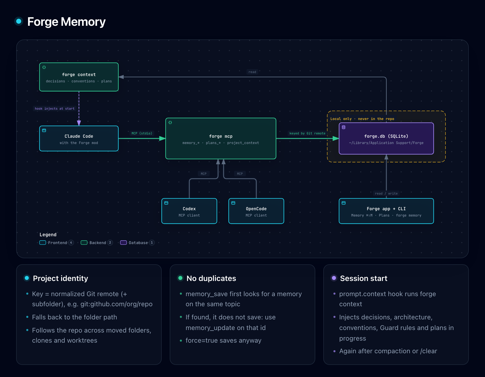
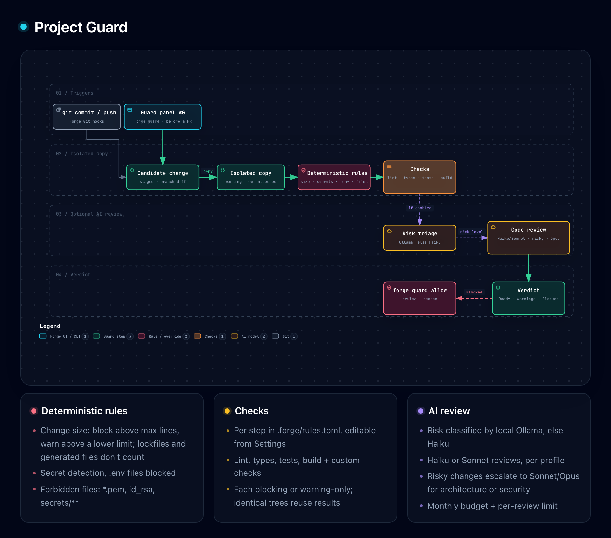

<div align="center">


# Forge

**A native macOS workspace for building software with AI agents.**<br>
Terminals, processes, agents, **Forge Memory** and a Guard that checks every change before it leaves your machine — one window per project.

[](https://github.com/DiegoAndres717/forge/actions/workflows/ci.yml)
[](https://github.com/DiegoAndres717/forge/releases/latest)


[](LICENSE)

[Download](#install) · [Features](#features) · [How it works](#how-it-works) · [Claude Code mod](#claude-code-mod) · [Shortcuts](#keyboard-shortcuts) · [FAQ](#faq) · [Español](README.es.md)


</div>

---

## Why Forge

When you work with Claude Code, Codex or OpenCode, your day is scattered across terminal tabs, dev servers, notes and "did the tests pass before I pushed?". Forge puts each project in one place:

- **Open a folder, get your setup back** — terminals, splits, running dev servers and agents, exactly as you left them.
- **Agents that plan and remember** — phased plans, the backlog and Forge Memory (the project memory) are shared with every agent through MCP.
- **Nothing ships broken** — Project Guard runs your rules (size, secrets, lint, tests, build) before each commit, push and pull request.
- **Native and light** — written in Rust with a GPU-rendered UI; no Electron, no embedded browser.

## Features

<table>
<tr>
<td width="50%"></td>
<td width="50%">

### Terminals and processes
Real terminals, **VS Code–style**: stack several in one panel (`⌘T`), switch from the side list, drag to reorder, and see which hidden ones printed something. Splits, search (`⌘F`), folder suggestions as you type and history that survives restarts. Managed processes (`dev`, `api`…) with restart, detected ports and health checks. Click an agent to jump back to its open terminal or resume its last session.

</td>
</tr>
<tr>
<td>

### Project Guard
Deterministic rules before **commit / push / PR**: change size, forbidden files, secret detection and your own checks (`npm test`, `cargo clippy`…), run in an isolated copy, plus an optional AI review by risk. Exceptions need a reason and are logged. Create the commit or open the pull request straight from the panel.

</td>
<td></td>
</tr>
<tr>
<td></td>
<td>

### Plans and Forge Memory
Tell the AI what you want to build and it saves a **plan in phases**, each with its branch and tasks it ticks off as it works; ideas for later go to the **backlog**. **Forge Memory** keeps the decisions, fixed errors and conventions, and fills itself: when you close an agent (Claude Code or Codex) its last conversation is saved as the project's "last session" note. Both are shared over MCP with Claude Code, Codex and OpenCode, and stored outside the repo. Two optional modes for every agent (Settings → Agents): **Ask first** (a few questions before planning) and **Tests first** (a failing test before the code, for all projects or per project; Guard can also warn when code changes without tests).

</td>
</tr>
<tr>
<td>

### Settings without editing files
Tabs, an ⓘ on every option, and forms for Guard, agents, AI review and processes that save as you type (keeping the comments in your `.forge/` files). Several **Claude Code and Codex accounts** side by side, each with its plan usage.

</td>
<td></td>
</tr>
</table>

Also: `⌘K` command palette for everything · confirmation before dangerous commands (`rm -rf` outside the project, `git push --force`, `DROP DATABASE`…), even from an agent, and before an agent reads a file with secrets (`.env`, `~/.ssh`, credentials…) · Git panel · macOS menu bar with every action · alerts with their own sound when an agent finishes or asks for approval, a process fails or Guard blocks (each one configurable in Settings → Alerts, with Do not disturb) · automatic updates · English and Spanish.

## How it works

### Forge Memory
Every agent opened in Forge reads and writes the same project memory over MCP. It's tied to the Git remote, refuses duplicates, and Claude Code gets the key decisions and plans in progress in the first message of every conversation.



### Project Guard
What happens between `git commit` (or push, or a pull request) and your change leaving the machine.



## Install

> **Requirements:** macOS 13 Ventura or later, on Apple Silicon or Intel (universal app). Linux and Windows are in preview: see [Linux](#linux-preview) and [Windows](#windows-preview).

Pick the command for your system:

| System | Where to paste it | Command |
|---|---|---|
| macOS, Linux | Terminal | `curl -fsSL https://raw.githubusercontent.com/DiegoAndres717/forge/main/scripts/install.sh \| sh` |
| Windows | PowerShell | `irm https://raw.githubusercontent.com/DiegoAndres717/forge/main/scripts/install.ps1 \| iex` |

The `curl … | sh` command does not work in Windows PowerShell (it has no `sh`), and Forge is not on winget.

### One command on macOS (recommended)

```sh
curl -fsSL https://raw.githubusercontent.com/DiegoAndres717/forge/main/scripts/install.sh | sh
```

It downloads the latest release, checks its SHA-256, installs `Forge.app` in `/Applications` (or `~/Applications`) and links the `forge` command. Run it again to update. Installed this way, macOS doesn't show the "cannot be opened" warning.

### Homebrew

```sh
brew install --cask diegoandres717/tap/forge
```

Update with `brew upgrade --cask forge`.

### Download

1. Download `Forge-x.y.z.dmg` from the [latest release](https://github.com/DiegoAndres717/forge/releases/latest).
2. Open it and drag **Forge** to **Applications**.
3. The first time, **right-click Forge → Open → Open**. Forge isn't notarized by Apple yet, so a plain double-click shows "cannot be opened". If macOS still refuses, run:

   ```sh
   xattr -dr com.apple.quarantine /Applications/Forge.app
   ```

### Build from source

```sh
brew install rustup && rustup-init -y      # Rust stable
git clone https://github.com/DiegoAndres717/forge.git && cd forge
./scripts/install-app.sh                   # builds and installs ~/Applications/Forge.app
# FORGE_UNIVERSAL=1 ./scripts/install-app.sh   → universal binary (Apple Silicon + Intel)
```

### Command line (optional)

```sh
ln -sf /Applications/Forge.app/Contents/MacOS/forge /opt/homebrew/bin/forge
forge help
```

### Linux (preview)

```sh
curl -fsSL https://raw.githubusercontent.com/DiegoAndres717/forge/main/scripts/install.sh | sh
```

The same command works on Linux (x86_64 or aarch64): it checks the SHA-256 and installs `forge` in `~/.local/bin`. Open it with `forge` or `forge <folder>`. Run it again to update.

| Works | Not yet |
|---|---|
| Terminals, agents, processes, Forge Memory, plans, MCP | Editor icons |
| Project Guard in zsh and bash | Automatic updates (run the installer again) |
| Desktop notifications and alert sounds (`paplay`), `xdg-open`, editors on PATH (`code`, `cursor`, `zed`…) | Folder suggestions while typing in bash (zsh only) |
| Menus in the ☰ button, folder picker with `zenity` or `kdialog` | |

Data goes in `~/.local/share/forge` (or `$XDG_DATA_HOME/forge`); settings in `~/.config/forge/config.toml`.

### Windows (preview)

In PowerShell:

```powershell
irm https://raw.githubusercontent.com/DiegoAndres717/forge/main/scripts/install.ps1 | iex
```

It downloads the build for your PC (x64 or ARM), checks its SHA-256, installs it in `%LOCALAPPDATA%\Programs\Forge`, adds `forge` to your PATH and creates a **Forge** entry in the Start menu. Run it again to update, even with Forge open.

| Works | Not yet |
|---|---|
| Terminals with PowerShell 7 (or Windows PowerShell); Forge follows `cd` | Folder suggestions while typing (zsh only) |
| Agents, processes, Forge Memory, plans, MCP | Clicking a notification doesn't open the project |
| Project Guard for dangerous commands: `git push --force`, `git reset --hard`, recursive `rm`/`del`/`Remove-Item` outside the project, also from Git Bash and Claude Code | Guard asking before an agent reads secrets (`.env`, `~/.ssh`) for Codex and Gemini |
| Windows notifications, sounds, folder dialog, editors on PATH (`code`, `cursor`…) | Automatic updates (run the installer again) |

Good to know:

- **SmartScreen:** Forge isn't signed yet, so Windows may warn the first time. Choose **More info → Run anyway**.
- **Scripts disabled:** with PowerShell's default policy your `$PROFILE` doesn't load and each terminal shows a warning (Windows Terminal does the same). Forge itself still works. To load your profile: `Set-ExecutionPolicy RemoteSigned -Scope CurrentUser`.
- **Data** goes in `%LOCALAPPDATA%\Forge` and **settings** in `%APPDATA%\Forge\config.toml`.
- **WSL** also works (install the Linux build inside Ubuntu), but the native version is simpler.

## Quick start

1. Open Forge and pick a folder (or drag one onto the window, or run `forge .`).
2. It works with no setup. To save your layout and processes, use **Settings → Create .forge/project.toml** in the sidebar: Forge fills it with the scripts it finds in `package.json`.
3. Click **Claude Code**, **Codex** or **OpenCode** in the sidebar to start an agent in the project. Click it again later and it takes you to its open terminal or resumes your last session (the row shows when and what it was about); **+** starts a new one.
4. Press `⌘G` before committing to see whether the change is ready.

## Claude Code mod

Any `claude` started inside a Forge terminal — typed by hand, `claude --resume`, `claude -c` or opened from the sidebar — loads Forge's mod automatically. Nothing is installed into your Claude config and nothing is added to your repo; outside Forge, Claude behaves as usual.

- **Cheaper subagents** — `forge:explorer` (Haiku) searches and reads code, `forge:reviewer` (Sonnet) runs tests and reviews, `forge:architect` (Opus) takes the hard problems. The main model delegates and keeps its context and cache: after three searches or reads in a row (shell `rg`/`grep`/`cat` included) Forge reminds it to hand the rest to the explorer. Other agents get the same advice over MCP, and Codex, Gemini CLI, OpenCode and Qwen Code can get `forge-explorer` and `forge-reviewer` subagents too (Settings → Agents): Forge picks a cheap model from Codex's catalog, shows which one they use, warns when there is none, and lets you type one.
- **Live status band** above the prompt — Guard status, plans in progress and backlog, the model working right now (● opus / ↳ explorer: … (haiku)), session tokens (new vs. cached) and your plan usage bars (5h and weekly).
- **Usage per model** — every turn, subagents included, is recorded; see it in Settings.
- **Starts with your project in mind** — every conversation (and every one after compaction or `/clear`) begins with the project's key decisions, conventions, Guard rules and plans in progress.
- **Keeps the goal in sight** — long contexts lose what's in the middle, so the phase you're on and its next tasks go at the end of your message (when it changes, and every few messages), the band warns at 60 % of the context, and **Start clean** in the agent's menu opens a fresh session that begins with a summary of the last one.
- **Several accounts** — Claude Code and Codex accounts side by side without signing out (Settings → Accounts): each has its own login and history and shares your settings, `CLAUDE.md` and skills; pick one per project from the agent's right-click menu. Move a conversation to another account and carry on where you were, or to another agent (Claude Code ↔ Codex…) with a short summary of what was done and what is left — also offered when an account hits its usage limit.
- **Zero-token commands** — `/forge-plans`, `/forge-guard`, `/forge-remember`, `/forge-memory`, `/forge-effort` (type `/forge` to list them).

## Forge commands in every agent

The same commands work in every agent opened from Forge (they come from Forge's MCP server):

| Agent | How to call them |
|---|---|
| Claude Code | `/forge-plans`, `/forge-memory`, `/forge-remember`, `/forge-guard` (mod, zero tokens) and `/mcp__forge__forge-plan` to plan an idea |
| OpenCode | `/forge:forge-plans`, `/forge:forge-memory`… |
| Gemini CLI, Qwen Code | `/forge-plans`, `/forge-memory`… (MCP prompts) |
| Codex | `$forge-plans`, `$forge-memory`… — Codex doesn't list MCP prompts, so turn them on in Settings → Agents → Codex → **Add to Codex** (writes skills to `~/.codex/skills`; **Remove** deletes only those) |

Write what the command needs right after it: `/forge-remember we bill with Wompi`, `$forge-memory payments`.

## Keyboard shortcuts

| Shortcut | Action | Shortcut | Action |
|---|---|---|---|
| `⌘K` | Command palette | `⌘G` | Project Guard |
| `⌘O` | Open folder | `⌘⇧M` / `⌘⇧I` | Memory / Plans |
| `⌘1`…`⌘9` | Switch project | `⌘⇧A` | Open agent |
| `⌃Tab` | Recent project | `⌘F` | Search in terminal |
| `⌘T` | New terminal (same panel) | `⌘B` | Toggle sidebar |
| `⌘⇧]` `⌘⇧[` | Next / previous terminal | `⌘]` `⌘[` | Next / previous panel |
| `⌘D` / `⌘⇧D` | Split right / down | `⌘⇧H` | Home |
| `⌘⌥←` `⌘⌥→` | Move focus | `⌘,` | Settings |
| `⌘⇧E` | Open the project in your editor (VS Code, Cursor, Antigravity, Zed…; also right-click the project) | | |

## Configuration

Per project, in `.forge/` (commit it to share with your team):

| File | What it holds |
|---|---|
| `project.toml` | Layout (terminals and splits), processes, commands |
| `rules.toml` | Guard rules and checks per stage |
| `agents.toml` | Agents and how to launch them |
| `routing.toml` | Model routing for AI reviews (`forge ai init`) |

Global settings live in `~/.config/forge/config.toml` (fonts and more). Plans, memory and history are stored in Forge's own database, never in the repo.

<details>
<summary><b>CLI reference</b></summary>

```text
forge [folder]                        opens the app (and that project)
forge guard commit|push|pr            checks whether the project is ready
forge guard status                    project rules, hooks and exceptions
forge guard allow <rule> --reason "…" adds an exception with a reason
forge guard history | report          latest validations / Markdown report
forge hooks install|uninstall|status  pre-commit and pre-push hooks
forge agent list | open <id>          detected agents / open one here
forge doctor                          checks git, database, settings, hooks and agents
forge ai route | usage                change risk / model usage this month
forge memory search|add|list|delete   Forge Memory (project memory)
forge plans [show|add|start|done|phase|task]   plans and backlog (outside the repository)
forge context                         project summary agents get at the start
forge mcp                             MCP server for agents
```

Run `forge help` for every option.

</details>

## FAQ

**Does Forge send my code anywhere?**
No. Forge runs locally; its only network call is the update check against GitHub Releases (plus the optional AI review, if you enable it in `routing.toml`). Agents you launch talk to their own providers as usual.

**Intel Macs? Windows?**
Intel Macs: yes, the app is universal. Linux: in preview (see [Linux](#linux-preview)). Windows: in preview (see [Windows](#windows-preview)).

**Do I need Claude Code?**
No. Terminals, processes, Guard, Git and plans work without any agent. Forge detects Claude Code, Codex, OpenCode, Gemini CLI, Qwen Code and Pi if they're installed.

**Why does macOS ask for access to Photos, Music or Documents?**
Because a program in a terminal asked for it — an agent, a script, `find ~`… macOS attributes it to Forge, as it does with Terminal or Warp, so the prompt says "Forge" and what you allow applies to what runs in its terminals. Forge itself never reads those folders. You can review it in System Settings → Privacy & Security.

**How do I report a bug?**
Open an [issue](https://github.com/DiegoAndres717/forge/issues) with what you did, what you expected and a screenshot if possible.

## Development

```sh
cargo test --workspace                                  # unit, integration and UI end-to-end
cargo clippy --workspace --all-targets -- -D warnings
FORGE_PREVIEW_DIR=/tmp/forge cargo test --release --bin forge ui_preview -- --ignored   # screenshots
scripts/measure-exploration.py --since 2026-10-01      # share of Claude Code's input spent exploring code
```

```text
crates/forge-core/   Core logic: Guard, hooks, agents, model routing, memory, MCP, SQLite
src/                 The app: window (egui), terminals, layout, processes and CLI
claude-plugin/       The Claude Code mod (validate: claude plugin validate claude-plugin)
tests/               Integration against the real binary: Git hooks and MCP server
```

UI end-to-end tests drive the real app with `egui_kittest` (no GPU needed), finding controls by their accessible names.

## License

[MIT](LICENSE) © Diego Andres Salas
